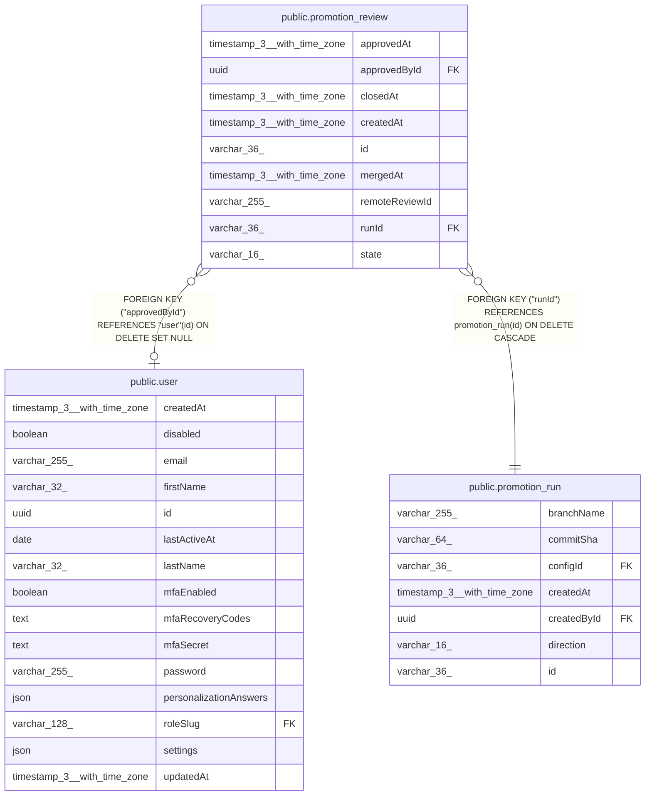

# public.promotion_review

## Columns

| Name | Type | Default | Nullable | Children | Parents | Comment |
| ---- | ---- | ------- | -------- | -------- | ------- | ------- |
| approvedAt | timestamp(3) with time zone |  | true |  |  |  |
| approvedById | uuid |  | true |  | [public.user](public.user.md) | The n8n user who approved the review in n8n. NULL when approval happened on the host. |
| closedAt | timestamp(3) with time zone |  | true |  |  | Mirrored from the host. |
| createdAt | timestamp(3) with time zone | CURRENT_TIMESTAMP(3) | false |  |  |  |
| id | varchar(36) |  | false |  |  |  |
| mergedAt | timestamp(3) with time zone |  | true |  |  | Mirrored from the host. |
| remoteReviewId | varchar(255) |  | false |  |  | Opaque reference to the review on the host. The prefix names the host kind, the rest is parsed by that host client, e.g. "gitlab:\<projectId\>!\<iid\>". |
| runId | varchar(36) |  | false |  | [public.promotion_run](public.promotion_run.md) | The promotion run that opened this review. |
| state | varchar(16) | 'open'::character varying | false |  |  | PromotionReviewState enum: "open", "merged", "closed". Only "open" rows are refreshed from the host. |

## Constraints

| Name | Type | Definition |
| ---- | ---- | ---------- |
| CHK_promotion_review_state | CHECK | CHECK (((state)::text = ANY ((ARRAY['open'::character varying, 'merged'::character varying, 'closed'::character varying])::text[]))) |
| FK_promotion_review_approvedById | FOREIGN KEY | FOREIGN KEY ("approvedById") REFERENCES "user"(id) ON DELETE SET NULL |
| FK_promotion_review_runId | FOREIGN KEY | FOREIGN KEY ("runId") REFERENCES promotion_run(id) ON DELETE CASCADE |
| PK_fe93e2f1add228dc14d3330c8e5 | PRIMARY KEY | PRIMARY KEY (id) |
| promotion_review_createdAt_not_null | n | NOT NULL "createdAt" |
| promotion_review_id_not_null | n | NOT NULL id |
| promotion_review_remoteReviewId_not_null | n | NOT NULL "remoteReviewId" |
| promotion_review_runId_not_null | n | NOT NULL "runId" |
| promotion_review_state_not_null | n | NOT NULL state |

## Indexes

| Name | Definition |
| ---- | ---------- |
| IDX_82d6930410e9e6c7d04c515079 | CREATE INDEX "IDX_82d6930410e9e6c7d04c515079" ON public.promotion_review USING btree (state, "createdAt") |
| IDX_8ddf41da9d492558353468b10b | CREATE INDEX "IDX_8ddf41da9d492558353468b10b" ON public.promotion_review USING btree ("runId") |
| PK_fe93e2f1add228dc14d3330c8e5 | CREATE UNIQUE INDEX "PK_fe93e2f1add228dc14d3330c8e5" ON public.promotion_review USING btree (id) |

## Relations

---

> Generated by [tbls](https://github.com/k1LoW/tbls)
